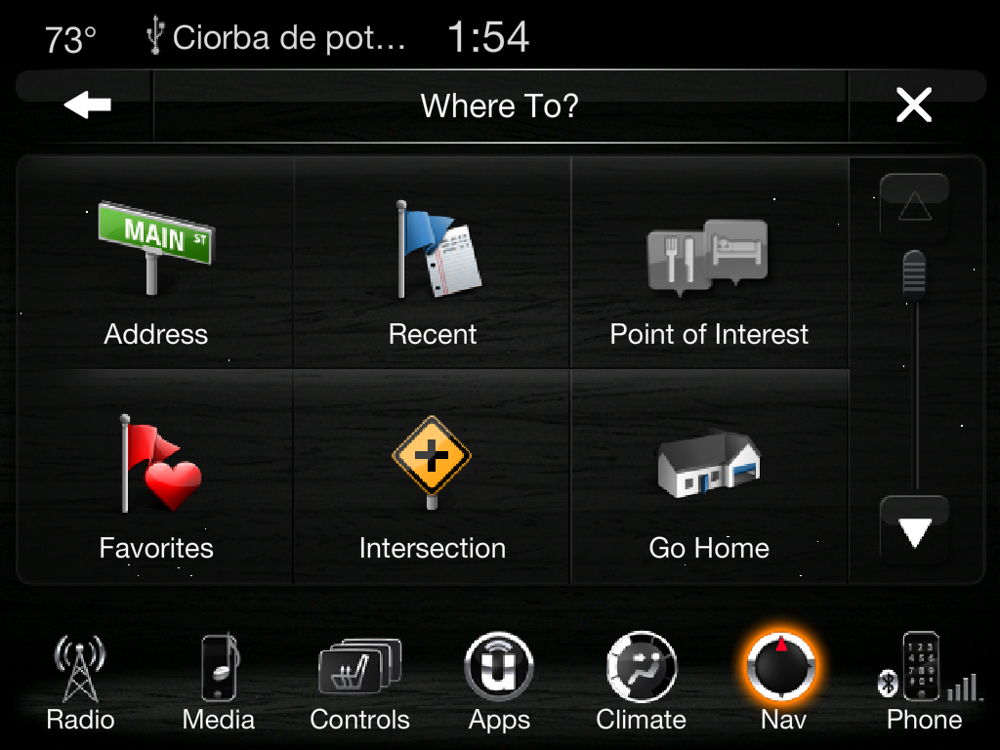

# Uconnect 8.4AN emulator

The **stock** Uconnect 8.4AN touchscreen software (RA4 17.43.01, MY15 NAFTA — Dodge/Chrysler/Jeep/Ram 2015-2017)
running on a Windows PC, straight out of the official USB update files. No head unit needed.


## What works

Runs at **1024x768** (the 640x480 HMI scaled 1.6x). Every screen below was tapped through in a scripted
regression tour with **zero script errors** in the HMI log:

| | |
|---|---|
|  **Radio** — AM/FM, station names, presets (store/recall), seek, direct tune |  **SiriusXM** — channels, categories, artist/song, presets, Traffic & Weather |
|  **Media** — **plays your real music folder** with tags, progress, seek, skip, repeat |  **Media browse** — folders, artists, albums, genres, songs |
|  **Phone** — paired "Pixel 8", favorites, incoming calls ringing with the car's own ringtone |  **Phonebook** — 22 contacts, favorites |
|  **Climate** — temp (LO/60-90/HI), fan 0-7, A/C, MAX A/C, recirc, AUTO, defrost, modes |  **Controls** — heated/vented seats, heated wheel |
|  **Settings** — Display, Units, Voice, Clock, Safety & Driving Assistance, Lights… (15 menus) |  **Apps** — app grid, drag icons to the menu bar |
|  **Nav menus** — Where To / View Map / Information / Emergency (no map drawing) |  **Where To?** — Address, Recent, POI, Favorites, Intersection, Go Home |

Also:
- **Boot splash** — the car's own brand splash images, chosen exactly like the firmware's `splash.lua` (brand + SRT/SiriusXM/Beats flags).
- **Themes** — all 46 brand themes (Dodge, Jeep, Chrysler, Ram, SRT, Viper, Fiat, Maserati…); switch from the panel or live in the head unit's own Settings.
- **Sound** — Media plays real files through Windows (play/pause/skip/seek, volume knob, mute); incoming calls ring.
- **Hardware panel** in the browser — volume & tune knobs, faceplate keys, climate knobs, gear shift, theme & splash pickers, restart, raw message injector.
- **CAN signal map** (`can/`) — 261 CAN message IDs / 1,511 signals (byte, bit, mask, PPS object) extracted from the firmware's `canservice`, for 9 vehicle CAN architectures.

## What can't work

Anything that is native QNX/ARM code in the real car: the **navigation map engine** (NaviServer), the **voice
recognition** engine and the Java **apps** (xlets). Their menus work; the map surface, speech and Java apps don't.

## Next update

- **Radio & SiriusXM sound** — map FM/AM/SXM presets to internet streams.
- **Bluetooth audio** source with its own playlist; pause music during calls (like the car's audio ducking).
- **Shuffle**, album art from embedded cover images.
- **Splash animations** — decode the `splash_movies/*.bin` boot animations.
- **Voice prompts** — play the stock VR beeps/prompts (`start.wav`, `recog_*.wav`).
- **CAN** — label which signal table belongs to which vehicle architecture; decode the transmit side in the V850 IOC firmware.
- **Uconnect 4C / 8.4 MY18+ (VP4R)** — needs the AES key or a decrypted dump from a unit (see below).

## Run it

Needs Windows, Python 3, and the free Adobe AIR 32 SDK (the runtime the car's HMI is built on).

```powershell
git clone https://github.com/JEtsKi8271/uconnect-emulator
cd uconnect-emulator
mkdir tools\airsdk
curl.exe -L -o tools\AdobeAIRSDK.zip https://airdownload.adobe.com/air/win/download/32.0/AdobeAIRSDK.zip
tar -xf tools\AdobeAIRSDK.zip -C tools\airsdk
pip install mutagen pillow
emulator\run.bat
```

The boot splash shows, then a 1024x768 head-unit window opens (mouse = touch) and the hardware panel opens at http://127.0.0.1:4401/.
**Sound:** your music folder (`~/Music`, or `"musicDir"` in `emulator/config.json`) is the USB stick: Media plays
the real files (mp3/m4a/wma/wav/flac) with their tags, following play/pause/skip/seek, the volume knob and mute.
Incoming calls ring with the car's own ringtone. Radio and SiriusXM stay silent.

Change brand/theme/language in `emulator/config.json`, vehicle equipment in `emulator/state.json` (`VehicleConfig`).

## How we got here

1. **Unpacking the update.** The 17.43.01 USB update (`swdl.iso`) contains `installer.iso`, `primary.iso` and
   `secondary.iso` — plain, unencrypted ISO9660 images of the head unit's QNX filesystems. Unlike newer units, the
   whole user interface ships in the clear: `primary.iso` → `usr/share/MMC_IFS_EXTENSION/share/hmi_rov` is a complete
   **Adobe AIR 2.5 app** (`main.swf`, `MainSupplement.swf` and ~150 per-screen SWFs, plus skins/themes for every brand).
2. **Running it.** Adobe's AIR 32 SDK still runs AIR 2.5 apps. With a small app descriptor (`emulator/hmi/emulator-app.xml`)
   `adl.exe` launches the stock HMI unmodified (first at 800x480, now 1024x768). It boots… and sits at a black screen waiting for the car.
3. **Reverse-engineering the protocol.** Decompiling the SWFs with [JPEXS FFDec](https://github.com/jindrapetrik/jpexs-decompiler)
   (sources in `decomp/`) showed the HMI talks to the car's native services over one TCP socket
   (`ModuleLink.xml` → `127.0.0.1:4400`) using NUL-terminated JSON:
   `{"Length":00085,"Type":"Command","Dest":"Tuner","packet":{...}}` out, `{"Tuner":{"frequency":...}}` back.
   Roughly 50 modules (`VehicleConfig`, `Audio`, `Tuner`, `Media`, `Hvac`, `Phone`, `SXM`, `Navigation`, persistency…)
   use `Subscribe` / `Command` / signal messages. `emulator/schema.json` lists every field each module reads,
   extracted from the AS3.
4. **Faking the car.** `emulator/backend.py` is a Python server that plays all those services: a generic module state
   machine (subscriptions, get/set properties, persistency) driven by `state.json`, plus per-feature behaviour in
   `handlers.py` and `emulator/modules/` (tuner, media library, HVAC zones, phone, SiriusXM, settings, nav).
   It also writes the binary `hmiVars` boot file (brand, theme, region, language) the car normally provides.
5. **Fixing the boot chain.** The HMI only shows its UI after `VehicleConfig` → `AudioManager` → `AppManager` report
   ready, and the disclaimer is accepted. Each AS3 runtime error (`Error #1069`, `#1010`, `#2007` …) pointed at a
   message with the wrong shape; fixing them one by one got every screen up. Notable gotchas:
   AIR's XMLSocket truncates frames sent in one burst (fixed with a per-connection paced writer queue);
   persistency reads must be `{"value":…}` objects; tuner presets are 0-based, media tracks 1-based.
6. **Parallel agents.** With the core working, a dev harness (`emulator/dev/uc.py`) runs isolated emulator copies
   side by side (own port, own AIR app id, screenshots, click injection) so several Claude Code agents built Phone,
   Settings, SiriusXM and Nav/Apps at the same time, each verifying by screenshot.
7. **Polish.** Real audio via Windows MCI, the stock boot splash, theme switching, 1024x768, and a nav start-up fix:
   the emulator now answers the nav engine's version query and its own persistence format, so nav reaches "ready"
   in ~8 s instead of a 20 s fallback (which had made incoming calls crash `MapController` right after boot).
8. **CAN.** The QNX boot image (`ifs-cmc.bin`, LZO-compressed) was unpacked with a small pure-Python unpacker, its Lua
   services decompiled with unluac, and the signal tables in `canservice` decoded and checked against `ChimeControl.lua`.

## Contributors

- [@JEtsKi8271](https://github.com/JEtsKi8271)
- [@exycalll](https://github.com/exycalll)
- Claude (Anthropic)

## Firmware downloads

The original update images are attached to the [v1.0 release](https://github.com/JEtsKi8271/uconnect-emulator/releases/tag/v1.0):

| File | SHA-256 |
|---|---|
| `swdl.iso` (full USB update) | `36E85189BB83EEE8CE6A8E1DC7E9EEFE917BB058CC5CD45EF65556E24827CD7C` |
| `installer.iso` | `C854220482E0F559142B7018A355085986443BBFB64DD0822B722C434314B512` |
| `primary.iso` | `1B60F7AAC9AB14B91176EE30D08603410B971A60A9E01094527A0B6113200645` |
| `secondary.iso` | `5335D54C2813EC11ACFB198534C4A021B7EF81B568C656B2E021103310CC8B09` |

## What about newer Uconnect (4C / 8.4 MY18+)?

The MY18-21 "VP4R" updates (e.g. `USA-ASO-8.4-QR-40.1.0`) are different: every package is AES-encrypted
(`encrypted_*.tar.gz`, per-file IVs in `ss_pasa_usb.metadata`) and the key is not in the update — it lives in the head
unit. Without a key or a decrypted dump from a unit, there's no HMI to run.

## Layout

- `emulator/` — the emulator (see `emulator/README.md`): `backend.py`, `handlers.py`, `modules/`, `state.json`, `hmi/` (stock HMI), `panel.html`, `dev/`
- `decomp/` — decompiled ActionScript of the HMI
- `can/` — extracted CAN signal tables (`can_signals.csv`, `can_ids.csv`) and the tools that produced them
- `docs/screenshots/`

Uconnect, Dodge, SiriusXM etc. are trademarks of their owners; the HMI and firmware are © Stellantis / Harman.
This is an unofficial research project.
